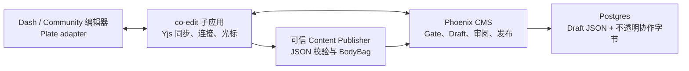

# co-edit：多人富文本编辑全链路 POC

> 状态：方案与 POC 验收合同，未实施；2026-10-30。
>
> 本文中的接口名、表名和状态名是拟定合同，不表示仓库已有实现。POC 通过后再确定正式命名与迁移顺序。

## 1. 目标和现有基线

目标是让两人或多人同时编辑同一份 Doc、Changelog 或 Post，实时看见内容、选区和带姓名的光标；断线和服务重启后能恢复已确认保存的内容；审阅与发布始终指向确定的一版。普通 Article 与 Doc 共用同步基础设施，但各自保留业务模型。

现有 [Article Draft/Revision 合同](../feature/article/revision-draft-target.md)是普通 Article 每篇一份服务端 Draft，Doc 按 `(article_id, branch_id)` 有 Draft；自动保存以 `expectedVersion` 整份写入，冲突时不能合并多人同时编辑。Doc 发布产生 `DocBranchVersion`，普通 Article 发布产生 `ArticleRevision`；发布事务消费并删除相应 Draft。Doc 的 Tree/Release、长期版本历史和恢复能力不能套到 Post/Changelog 上。浏览器内 `LocalDraftHistory` 是单设备恢复能力，不是多人协作日志。

现有 [Content Publisher](./content-publisher.md)规定：可信 Node 将原始富文本转成 canonical BodyBag，再经服务身份、委托用户身份和 Phoenix CMS Command/Gate 写入。协作接入后继续遵守此边界；浏览器不能生成可信 BodyBag，`co-edit` 不能直连 Phoenix 数据库。

## 2. 架构决定

| 层                   | 拥有                                                                      | 不拥有                                               |
| -------------------- | ------------------------------------------------------------------------- | ---------------------------------------------------- |
| 编辑器 adapter       | Plate 与协作 provider 的连接、光标展示、编辑状态 UI                       | 业务授权、最终保存或发布结果                         |
| `co-edit` 独立子应用 | WebSocket 同步、Y.Doc、Awareness、房间运行时、断线重连、更新归属采集      | Article/Doc 领域模型、最终业务权限、独立的持久数据库 |
| Phoenix              | 用户与 Gate、Draft/Revision、审阅/排期/发布事务、持久化确认、命令 Receipt | Yjs 合并算法、WebSocket、光标坐标、领域 `Room` 实体  |
| Content Publisher    | 编辑器 JSON 到 BodyBag 的可信转换和校验                                   | CRDT 同步与业务状态机                                |

`co-edit` 是可独立部署、扩缩容的子应用；UI 仍在现有产品前端。**协作房间**只是传输层的连接键，由 `co-edit` 从 Phoenix 给出的目标身份和代际编号生成。Phoenix 不保存 room ID，也不暴露“创建房间”业务用例。Phoenix 只认识 `article_id`，以及 Doc 必需的 `branch_id`；另有基础设施级 `workspace_epoch` 用来隔离旧连接。

POC 选 [Plate `@platejs/yjs`](https://platejs.org/docs/yjs) + Yjs + [Hocuspocus](https://tiptap.dev/docs/hocuspocus/) 为第一种适配器实现。Hocuspocus 由 Tiptap 维护，可以服务 Plate/Slate 的 Yjs 文档，但它的 provider 协议及 Yjs 二进制并非跨同步方案的通用合同。更换服务时只替换编辑器 provider adapter 和 `co-edit` 的 sync adapter；Phoenix 的业务 API、RichContent JSON 和发布模型不依赖 Hocuspocus。Plate 当前文档支持自定义 provider、Awareness 和远端光标。POC 要先验证仓库使用的 Plate 版本与该接口的兼容性，不将官网最新示例直接视为现有代码可运行。

## 3. 三类状态，两个持久化表示

| 数据                              | 存储与寿命                                                                 | 用途                                                          |
| --------------------------------- | -------------------------------------------------------------------------- | ------------------------------------------------------------- |
| 富文本 `RichContent JSON`         | Phoenix 的 Draft/已发布正文；业务长期合同，带 `schema_version`             | 渲染、Diff、导入导出、审阅、发布；通过 Publisher 生成 BodyBag |
| Yjs 更新与压缩后的二进制快照      | Phoenix 基础设施存储，关联目标与 `workspace_epoch`；发布后可按恢复策略清理 | `co-edit` 崩溃或重启后无损恢复尚未发布的协作工作区            |
| Awareness（光标、选区、在线姓名） | `co-edit` 内存/连接，断线即失效                                            | 实时呈现，不作审计或作者归属证据                              |

只存 JSON、每次连接重新构造 Y.Doc 会丢失 CRDT 历史并可能重复合并内容；[Hocuspocus 持久化文档](https://tiptap.dev/docs/hocuspocus/guides/persistence)明确要求保留二进制。Phoenix 可以保存这些**不透明字节**，但不解码、不执行 CRDT。一个工作区必须同时保有 JSON 业务表示与二进制同步表示，配对生成并持久化的 JSON checkpoint 与二进制快照共享 `checkpoint_seq` 与 hash；独立压缩的最新二进制快照可更旧，以 `snapshot_seq` 标记。原始更新流可领先两者，另记 `durable_seq`。普通读取只用 JSON。恢复协作优先加载同代二进制；仅在新工作区第一次初始化时从当前 Draft 或已发布正文种子化一次，不能在已有 Yjs 历史上再次灌入 JSON。

“JSON based” 只解决对外内容合同问题；当前 Plate JSON 本身仍可能带编辑器特定节点。POC 要定义最小版本化 `RichContent` schema（块类型、稳定 block ID、内联标记、链接、嵌入等）和 `Plate ↔ RichContent` adapter，列出不支持的节点并拒绝静默丢失。Yjs 字节不出现在公开 Article/Doc API。若将来换编辑器，同一 JSON 样本应能无损读写；如果不能，先迁移 schema/adapter，不能声称“用了 JSON 就解耦”。

## 4. 连接、保存和发布协议

下面的操作名是 POC 合同，具体走内部 HTTP、GraphQL 或已有 CMS facade 由实现阶段决定；都要复用现有 Auth、Gate、Publisher 和 CMS Command，而非另设业务写通道。

### 4.1 连接与授权

1. 浏览器以正常会话请求 `open_edit_session(target)`；`target` 为普通 Article 的 `article_id`，或 Doc 的 `(article_id, branch_id)`，不能由客户端传任意 room 字符串。
2. Phoenix 加载目标、检查 Gate 的编辑权限与 Draft/审阅状态，返回短期、限目标和操作的连接凭证、授权决定 ID 及当前 `workspace_epoch`；凭证含真实 `user_id`，显示名/颜色由可信资料生成。
3. 浏览器通过 Gateway 连接 `co-edit`。`co-edit` 验证凭证及 epoch，必要时向 Phoenix 查询最新撤权/封存状态；凭证到期或权限撤销时中止写入并断开连接。只读人员可另设只读 scope，不得借只读连接发送内容更新。
4. `co-edit` 按目标与 epoch 加载 Phoenix 保存的 Yjs 二进制；首次初始化要用原子“仅当不存在”创建，两个连接同时进入不得分别种子化。Awareness 广播中的姓名与身份绑定到已验证用户，不信任客户端任意填报。

### 4.2 同步与耐久确认

1. 编辑器把操作交给 Yjs，`co-edit` 向同工作区连接广播；多光标用 [Yjs Awareness](https://docs.yjs.dev/getting-started/adding-awareness)传输。Awareness 不写入正文。
2. 每条入站更新绑定服务端确认的 `user_id`、目标、epoch 和单调 `seq`。Phoenix 的内部追加接口对 `(target, epoch, seq)` 幂等写入不透明更新；只允许当前 epoch，返回 `durable_seq`。周期性压缩二进制并生成 JSON checkpoint，但压缩不能删除尚未包含在快照中的更新。
3. **收到远端更新 ≠ 已保存。** 编辑器只有在 Phoenix 持久化确认覆盖本地更新后才显示“已保存”；否则显示“同步中/未保存”。Hocuspocus 默认 `onStoreDocument` 有 debounce，不能直接把该 hook 触发或 WebSocket 回声当成耐久确认；POC 必须实现可关联客户端更新的保存水位回执，或把 UI 明确标为“已同步，待保存”。
4. 同一次持久化的 JSON checkpoint 与二进制快照要带相同 `checkpoint_seq` 和内容 hash；分别记录 `content_schema_version` 与 `sync_format_version`。checkpoint 走可信 Publisher 校验后写 Draft；更新流与 checkpoint 的事务/水位关系必须保证重启后能重放到至少已确认保存的水位。Phoenix 暂不可用时，co-edit 仅在授权决定仍有效且缓冲窗口内暂存更新，暂停“已保存”确认；达到有界缓冲后拒绝继续接受写入；不能无限积压在 `co-edit` 内存中。

现有整份 JSON、约 1600 ms 的自动保存不能与 Yjs 同时写同一 Draft，否则会互相覆盖。启用协作的工作区改由 `co-edit` checkpoint 驱动 Draft；旧 autosave 仅用于未启用协作的编辑器。协作期间 `LocalDraftHistory` 只读展示本机未确认差异；恢复须先加载服务端工作区，再由用户显式提交差异为新操作。旧 epoch 的整份 payload 不得自动回填。

### 4.2.1 POC 最小接口合同

这些是跨服务消息的**语义字段**，不是已经存在的 URL 或 GraphQL schema。每个内部写请求还需 service credential；用户发起的业务命令须带受限目标的 delegated actor，协作 checkpoint 使用下述专用 service policy；所有请求还需 `command_id`/幂等键、`trace_id`；Phoenix 从可信凭证解析 actor，不信任 payload 中自报的用户。

| 操作                                                                                    | 最小输入                                                                                                                                                                                | 成功输出 / 冲突                                                                                                                                                |
| --------------------------------------------------------------------------------------- | --------------------------------------------------------------------------------------------------------------------------------------------------------------------------------------- | -------------------------------------------------------------------------------------------------------------------------------------------------------------- |
| `open_edit_session`                                                                     | `target={article_id, branch_id?}`、用户会话                                                                                                                                             | 短期 `co_edit_token`（签名 claim 含唯一权威 `authorization_decision_id`、target/actor/scope/epoch/有效期）、`workspace_epoch`、权限；无权限 `forbidden`        |
| `renew_edit_session`                                                                    | target、当前用户会话、旧 token/decision ID                                                                                                                                              | 重新执行 Gate，签发新 token（claim 含新 decision ID、`workspace_epoch` 与有效期），并返回当前 `workspace_epoch`；撤权或旧 epoch 返回 `forbidden`/`stale_epoch` |
| `load_sync_state`                                                                       | target、epoch                                                                                                                                                                           | 最新二进制快照、`snapshot_seq`（配对快照等于对应 `checkpoint_seq`，独立快照可更旧）、其后更新流、`durable_seq`；已封存/旧代 `stale_epoch`                      |
| `append_sync_update`                                                                    | target、epoch、`seq`、`update_id`、二进制更新、连接/续期时 Phoenix 签发的 `authorization_decision_id`、co-edit `accepted_at`                                                            | `durable_seq`；重复 update 幂等返回原水位；旧代 `stale_epoch`                                                                                                  |
| `checkpoint_draft`                                                                      | target、epoch、覆盖至 `seq` 的 JSON/hash、可信 Publisher 产出的 BodyBag、Draft `expected_version`                                                                                       | 新 Draft version、`checkpoint_seq`；冲突时协调，不覆盖                                                                                                         |
| `freeze_workspace` / `freeze_ack`                                                       | Phoenix 发 target、epoch、`seal_id`；co-edit 回最后已接收的 `seal_seq`                                                                                                                  | 同一 seal 幂等返回同一 fence；立即停止接收新写入                                                                                                               |
| `seal_candidate`                                                                        | 普通 Article target、epoch、`seal_id`、`command_id`；Doc 成员只能由 `seal_release` 内部创建，客户端不提交水位                                                                           | 固定候选、`sealed_seq`、public base；未追平返回 `not_drained`                                                                                                  |
| `unfreeze_workspace`                                                                    | target、epoch、`seal_id`、租约代际                                                                                                                                                      | co-edit 确认恢复可写；只在 Phoenix 状态仍为可编辑时解冻                                                                                                        |
| `abort_seal` / `withdraw_candidate`                                                     | seal/candidate ID（`withdraw_candidate` 仅限普通 Article；Doc 统一 `withdraw_release`）、授权 actor、`command_id`                                                                       | 失败 seal 恢复可写；撤回使审阅/排期失效并以新 epoch 重开                                                                                                       |
| `seal_release`                                                                          | branch、固定 `doc_change_ids`/`tree_change_ids`、`expected_checklist_revision`、tree revision、public base、`command_id`；首轮不支持 `restore_tree_change_ids`，不输入成员 candidate ID | 冻结完整 manifest 与成员工作区，内部创建全部成员 candidate；返回 `release_id`、`manifest_hash`、成员 candidate ID；任一失败整体 abort                          |
| `publish_release`                                                                       | `release_id`、`manifest_hash`、授权 actor、`command_id`                                                                                                                                 | 只消费已固定 manifest；`publish_doc_changes` 原子发布全部成员，缺失或过期拒绝                                                                                  |
| `approve_release` / `schedule_release` / `cancel_release_schedule` / `withdraw_release` | release ID、manifest hash、审核/排期/撤回 actor、`command_id`                                                                                                                           | 审批与排期只绑定完整 release；撤回任一成员须撤回整个 release 并使全部审批与排期失效                                                                            |
| `rebuild_workspace`                                                                     | target、保留 Draft version、授权 actor、`command_id`                                                                                                                                    | 仅在无 sealing/待审候选/有效 release，且二进制历史不可恢复、工作区已隔离时退役旧 epoch，从保留 Draft 创建新 epoch；未 checkpoint 的更新明确报告丢失风险        |
| `schedule_candidate` / `cancel_schedule`                                                | candidate ID、时间或取消原因、actor、`command_id`                                                                                                                                       | 持久化状态与 Receipt；首轮仅用测试夹具模拟到期触发                                                                                                             |
| `approve_candidate` / `publish_candidate`                                               | `candidate_id`、候选 hash、审核/发布 actor、`command_id`                                                                                                                                | 固定审核结果或 CMS Command Receipt；候选/权限变化时拒绝                                                                                                        |

二进制更新大小、JSON 大小与频率要限额。`append_sync_update` 的确认是内容持久化水位，`checkpoint_draft` 是业务可读 JSON 水位；两者可以短暂不同，但 `seal_candidate` 必须把 JSON 追到全部已确认的二进制更新后才能形成候选。所有读取和重放都只接受同一 epoch 的序列；不能把旧连接更新写入新 Draft。

### 4.3 审阅、定时和发布

1. 有权限者发起 `seal_candidate(target, expected_epoch, command_id)`。Phoenix 原子置 `sealing`，调用 `freeze_workspace`；co-edit 停写后以 `freeze_ack` 确定 `seal_seq`。Phoenix 追加事务只接受该 epoch 下已接收且 `seq <= seal_seq` 的在途更新，拒绝新写入。二进制与 JSON checkpoint 均追到 fence 后原子创建候选并提升 epoch；冻结状态与 `seal_id`、租约截止时间持久化在 Phoenix；co-edit 重启时先读取状态，不能默认解冻。超时或未确认更新则 `abort_seal`，Phoenix 先持久化回到可编辑态，再发 `unfreeze_workspace`；通知丢失时 co-edit 以 Phoenix 状态和租约代际重试确认。租约过期由 Phoenix 原子中止 seal，co-edit 复核后自动解冻；不能丢弃已确认更新。
2. co-edit 的可信 Node 运行时调用共享 Content Publisher package，将冻结 JSON 转成 canonical BodyBag 后以受限 service credential 交给 Phoenix；Phoenix 不执行 Node package。checkpoint 使用限目标的协作 service principal 和专用 Gate service-actor policy：仅允许已有有效协作工作区的正文 checkpoint，须校验目标、epoch 与接收更新时记录的 actor 授权证据；checkpoint 不重新校验历史贡献者的现时权限：Phoenix 在 `open_edit_session` 和续期时按 Gate 签发短期、限 target/epoch/actor/scope 的授权决定，记录 permission version、有效起止时间和 decision ID。Phoenix 将 decision ID 仅作为 token 中签名绑定的 claim 返回浏览器；浏览器只转交 token，不能单独指定 decision ID；`append_sync_update` 忽略任何客户端另行提交的 ID。co-edit 验签后从 claim 读取 decision ID，并核对 target、epoch、actor、scope 与有效期；续期须调用 `renew_edit_session` 并替换连接凭证，旧决定只覆盖其有效期内已接收更新。co-edit 在决定有效期内接收更新并以其可信服务器时钟记录 `accepted_at`；Phoenix 追加时按该时间是否处于决定有效期、对应 scope 和撤权生效时间验证，不把 Phoenix 落盘时间当成接收时间。co-edit 时钟偏差超限则拒收；离线缓存只允许在决定有效期和有界缓冲窗口内，决定记录保留期至少覆盖该窗口及重放期。Phoenix 将 `(target, epoch, update_id, actor_id, accepted_at, persisted_at, permission_version, token_expires_at, authorization_decision_id)` 与更新同事务持久化；重启后从该记录恢复历史授权，不能由客户端自报时间或证据。撤权后拒绝该 actor 的新更新，撤权前已持久确认的更新仍由 service principal checkpoint 保存。已接收但尚未持久确认的更新须先按接收时授权完成落盘并回执，或明确失败且不得显示“已保存”；撤权不追溯删除已确认内容。此能力不允许 seal/publish 或修改其他业务字段，也不把合并结果归给最后编辑者，不生成用户 Activity。Gate 在连接授权与 seal/publish 时还校验真实用户；每条更新和可可靠识别的 Block 单独保存 actor，审计同时记录 service principal 与触发者。
3. 协作 checkpoint 只写正文。title/tags/cover、Doc subtitle/slug、Changelog version/release/link、Post copyright 等 typed fields 仍由现有业务 command 写入，Doc tree 仍走 tree command；所有入口在提交事务中统一检查 workspace seal guard，并与 seal 获取相同的 Draft/branch tree 事务锁；seal 读取最终 Draft version、tree revision 和 manifest 前先取得这些锁。先提交的写进入候选，seal 先取得锁时在途写返回 sealing/conflict 并重试；不能在候选创建后提交。seal 前允许这些字段并发写；checkpoint 遇 `expected_version` 冲突时重读 Draft version 与 typed fields，保留 Yjs 状态并重试正文写入，不能整份覆盖。候选固定正文、全部适用 typed fields、Draft version 和 `base_revision_id`；Doc 另固定 branch、`base_branch_version_id`、tree revision 以及 release manifest 中全部 `doc_change_ids` / `tree_change_ids`。sealing 冻结这些字段的所有写入口。`seal_release` 先固定 branch 级 manifest、`expected_checklist_revision` 和 tree revision；首轮拒绝非空 `restore_tree_change_ids`，不静默忽略；再冻结所有成员工作区，内部逐个创建 member candidate，最后原子确认 release。失败时整体 abort/unfreeze。Doc 成员禁止独立 `seal_candidate`；未归属 release 的 Doc candidate 不可审阅、排期或发布。`publish_release` 经现有 `publish_doc_changes` 原子消费 manifest 和全部候选；单篇 candidate 只是 release 成员。审阅对比固定 public base；线上版本前进时标记 stale，发布拒绝并要求重新 seal/审阅。
4. Doc 的唯一审批、排期和发布单位是固定 release；成员 candidate 不能单独审批、排期或调用 `publish_candidate`。Doc release 默认强制审阅：另一位具有该 branch release 发布权限的管理员审批完整 manifest；任一成员正文作者或 release 发起人自审均拒绝。`approve_release` 只审核完整 manifest hash，不逐篇审批；`publish_release` 要求该审批仍有效并再次校验审批者权限。任一成员撤回都调用 `withdraw_release`，整个 release 及其审批、排期立即失效；Phoenix 原子退役全部成员的冻结 epoch，再通知 co-edit 对所有成员 `unfreeze_workspace`，以新 epoch 从保留 Draft 恢复可写。通知丢失时按 Phoenix 状态重试，不保留孤立冻结成员。`approve_candidate`、`schedule_candidate`、`publish_candidate` 仅用于 Post/Changelog 等普通 Article。**Doc** 复用现有 branch-scoped 发布，POC 新增 release 审阅/审批；**Changelog** 的他人审阅配置与审批也是拟新增能力，默认无需审阅。开启后须由另一位合格管理员审核固定候选。Post 沿自身发布规则。发布时重新检查 Gate、审阅配置与固定 public base。
5. 普通 Article 排期引用固定 `candidate_id`，Doc 排期引用固定 release ID 与 manifest hash，到时重新检查权限、审阅和 public base。首轮 P9 使用持久化排期记录与可重复的手工到期触发夹具；完整调度器不在范围内。
6. Phoenix 按现有 CMS Command/Receipt 事务发布：Doc 创建对应 `DocBranchVersion` 并按 Tree/Release 合同处理；普通 Article 创建 `ArticleRevision` 并切换 Public 指针。成功后删除被消费的全部 Draft、标记候选已发布、退役旧 epoch。重复命令返回原 Receipt；失败不产生半发布状态。

**POC 选择冻结工作区**：候选进入审阅/排期后，不允许继续向同一 Draft 写。要修改时撤回候选，重新打开工作区、编辑、seal 并重新审阅/排期；发布成功后才允许从已发布版本创建下一份 Draft。这样与当前“发布后删除 Draft”语义一致，也避免审核通过后又混入新内容。代价是审阅期间无法继续编辑；未来若确有并行修改需求，需另设计候选与新工作区的分离及 Draft 消费规则，不能只放开写权限。

工作区生命周期：publish、discard、trash、永久删除、Doc branch delete 均退役 epoch 并断开旧连接；trash 不保留可写的协作二进制工作区。trash 保留业务 Draft 与 Doc staged tree state，只退役协作二进制 epoch。restore 继续编辑原 Draft，并从该 Draft 一次性种子化新 epoch 的协作工作区，不复用旧二进制。永久删除清理二进制；其他操作依可审计保留期清理。状态与 epoch 在 Phoenix 事务中一起更新，异步清理不能让旧 epoch 再有效。

## 5. Block 级变更与参与者

Doc release 审阅对**release 中每个固定成员候选与其固定 public base 正文**显示 Block 级 Diff：新增、删除、内容变化，以稳定 `block_id` 对齐；只改格式也应标明。一个 Block 的多位参与者由 `co-edit` 在接受更新时记录可信 actor，并将更新影响的 block ID 归集成可审计元数据。名字不是从最终文本 Diff 反推，也不是从 Awareness 光标推断。UI 可以说“这个 Block 由 A、B 参与编辑”，不能说“A 改了这几个字”。

编辑器使用按本地 origin 和用户 scope 配置的 Yjs UndoManager；本地 undo 仅回退本人操作，不回退其他参与者的更新。

Block ID 必须在重连、checkpoint 和发布后保持稳定。拆块、合块、粘贴、删除、撤销及 AI/导入器改写需要明确归属规则；如果 Yjs 更新无法可靠映射到最终 Block，展示“参与者未确定”，不能猜测。普通 Post/Changelog 可以复用变更采集，但首轮可只做实时协作；不要为了 Doc Diff 迫使普通 Article 保存长期版本图。

## 6. POC 实现切片与验收

POC 在本地独立启动 `co-edit`，使用真实 Phoenix/Auth/Gate/Postgres 与两个独立浏览器会话；首轮每工作区最多 2 名同时编辑者，第三名写连接明确拒绝。以下每项都要留自动化用例或可重复的脚本、日志/数据库断言；不能仅靠录屏证明“看起来能用”。

| 编号 | 操作                                                                                                                                                                                                                          | 必须观察到                                                                                                                                                                                                                                                                     |
| ---- | ----------------------------------------------------------------------------------------------------------------------------------------------------------------------------------------------------------------------------- | ------------------------------------------------------------------------------------------------------------------------------------------------------------------------------------------------------------------------------------------------------------------------------ |
| P1   | A、B 同开一篇 Doc 的同一分支，交错编辑同 Block 与不同 Block                                                                                                                                                                   | 两端最终 JSON/hash 一致；显示各自姓名、光标和选区；没有重复节点或丢字                                                                                                                                                                                                          |
| P2   | 同一 Article 的两个浏览器先后进入、同时进入、再重连                                                                                                                                                                           | 只有一次初始化；使用同一工作区；旧 epoch 凭证不能写新工作区                                                                                                                                                                                                                    |
| P3   | A 获得“已保存”后杀死 `co-edit`，重启并由 B 打开                                                                                                                                                                               | 恢复内容至少覆盖已确认 `durable_seq`；恢复后再次并发编辑仍收敛                                                                                                                                                                                                                 |
| P4   | Phoenix 暂时不可用、A 离线、网络乱序/重复发送                                                                                                                                                                                 | UI 不误报已保存；重放幂等；恢复后收敛；缓冲上限触发可见错误                                                                                                                                                                                                                    |
| P5   | 编辑途中撤销 B 的编辑权限，或用伪造的目标/姓名/旧凭证连接                                                                                                                                                                     | B 不能继续写；不能越权读正文或冒名显示光标                                                                                                                                                                                                                                     |
| P6   | A seal，B 同时发送最后更新；随后审阅、撤回、再 seal                                                                                                                                                                           | 已承诺保存的更新要么进确定候选，要么 seal 明确失败；审阅对象 hash 不漂移                                                                                                                                                                                                       |
| P7   | Changelog 默认无需审阅直接发布；开启“他人审阅”后分别尝试自审和他审                                                                                                                                                            | 默认路径可发；自审被拒；他审通过后只能发布该候选；成功后 Draft 删除                                                                                                                                                                                                            |
| P8   | 按先 `seal_release` 创建两篇 Doc 正文加一项 tree change 的成员候选，成员正文作者自审、release 发起人自审、合格他审、排期、撤回成员并重建 release 后发布；非空 restore tree change 明确拒绝；恢复已发布版到新 Draft；Post 发布 | 成员正文作者与 release 发起人分别自审均被拒，另一位具备 branch release 权限的管理员审批通过后才能发布；Doc 保留 branch version/Tree/Release 语义；撤回后全部成员以新 epoch 恢复可写，旧审批与排期失效；Doc 成员不可单独发布；Post 无 Doc 分支/长期历史；两者都不发布未确认更新 |
| P9   | 分别排期 Changelog 等普通 Article candidate 与 Doc release 后尝试继续编辑；仅修改 Changelog 审阅配置，再重复触发发布                                                                                                          | Doc 成员不能单独排期；写入被拒或需撤回；到期复查规则；Receipt 幂等，Public 只切换一次                                                                                                                                                                                          |
| P10  | 富文本样本往返 Plate JSON ↔ RichContent，包含链接、代码、列表、嵌入、block ID；替换 provider adapter 做一次连接验证                                                                                                           | 受支持节点无语义丢失；不支持节点明确报错；Phoenix 合同及发布命令无需改动                                                                                                                                                                                                       |
| P11  | title/tags/cover/typed fields/tree command 在 seal 前启动并与 seal 竞争提交，及 seal 后写入；public revision 在审阅中前进；本地 undo                                                                                          | 按事务锁决定先提交写入进入候选或被拒；checkpoint 不覆盖非正文，seal 后明确拒绝；过期候选不得发布；撤销只影响本人操作                                                                                                                                                           |
| P12  | 撤权前更新已接收但未 checkpoint；活跃连接时 discard/trash/delete/restore；到期前续期并写入、token 到期或只读连接写入；二进制丢失但 JSON 仍在                                                                                  | 已确认更新可 checkpoint，未确认更新须落盘回执或明确失败；续期成功时新 token/decision 可继续写，过期或越权写入拒绝；旧 epoch 全部失效；不从 JSON 静默重建已有协作历史，经 `rebuild_workspace` 显式修复                                                                          |

### POC 通过门槛

- P1–P12 的结果有可复现证据；尤其 P3、P4、P6、P7 不能降格为手工“基本正常”。
- 保存水位、JSON hash、epoch、`candidate_id`、Doc `release_id` 与 `manifest_hash` 可串起一条 trace，日志不记录正文或凭证。
- 记录 2 人（当前上限）下的同步延迟、Phoenix 追加写入量、checkpoint 大小、恢复时间和断线率。数字用于决定批量与压缩策略；POC 前不预设生产阈值。
- 未通过 schema 往返或崩溃恢复前，不替换现有非协作编辑器写链。

## 7. 具体实现顺序与待验证选择

1. 固定 `RichContent` v1 schema、Plate adapter 和 P10 样本；先确认现有编辑器扩展点与节点兼容性。
2. 建 Phoenix 基础设施级二进制更新/快照与 epoch 水位存储、内部授权/追加接口；保留现有 Draft/Revision 领域表作为业务权威，不让 `co-edit` 直连数据库。
3. 建 `co-edit` 独立运行时及编辑器 adapter；先完成双人同步、命名光标、初始化和 P1–P5；以 P12 的重启、凭证及生命周期场景作为该切片回归门禁。
4. 接 Publisher checkpoint、seal candidate / release、审阅/排期规则与现有发布命令，完成 P6–P9，并以 P11 的并发与 public base 场景作为发布门禁。切换某种编辑器时同时关闭其旧整份 autosave，按 Doc、Changelog、Post 逐一开启。
5. 加 Block 参与者、Diff 与 Doc 历史 UI；只有归属可信且 ID 稳定后才展示参与者。

生产拓扑仍需在 POC 中选定：单实例可先验证语义；多实例必须对每个 `(target, epoch)` 保证单写者或等价的序列化/共享更新机制，且有租约栅栏，不能靠进程内锁扩容。还要决定更新日志保留期、快照频率、工作区大小上限及迁移时如何同时处理 JSON schema 与二进制版本。这些是上线门槛，不改变 Phoenix 与 `co-edit` 的所有权边界。

## 参考

- [Plate Collaboration](https://platejs.org/docs/yjs)：Yjs、Awareness、远端光标、provider 与初始化接口。
- [Yjs Document Updates](https://docs.yjs.dev/api/document-updates)与 [Awareness](https://docs.yjs.dev/getting-started/adding-awareness)：二进制更新及短期在线状态。
- [Hocuspocus Persistence](https://tiptap.dev/docs/hocuspocus/guides/persistence)与 [Server Hooks](https://tiptap.dev/docs/hocuspocus/server/hooks)：加载、保存、认证扩展点及 debounce 边界。
