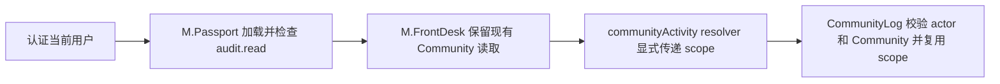

# GraphQL 字段内的 Passport Scope（提案）

> 状态为提案，尚未实现。Passport 持久化与 Action 合同见
> [Passport Permission 与 Community Admin](../migrations/passport-permissions-refactor.md)。

## 目标

同一个 GraphQL 字段内，由现有 `M.Passport` 加载 typed scope，resolver 显式交给
该字段的下游授权检查复用。Passport Store 提供权限事实，Gate 继续组合 Passport、
资源关系和 Lifecycle 作最终准入判断。沿用现有 middleware，不恢复 `PassportLoader`。

## 首批仅接入 `communityActivity`

现有字段依次执行 `M.Authorize`、`M.Passport(action: "audit.read")`、
`M.FrontDesk, :community` 和 resolver。Passport 加载 Community scope 并当场判权，
随后返回原 resolution。resolver 调用 `Activity.list_community_logs`，
`CommunityLog` 再从 Store 加载同一用户和社区的 scope，用于检查 `audit.read`
以及决定是否展示私有 Admin 事件。
[GraphQL 字段](../../backend/api/lib/groupher_server_web/schema/cms/cms_queries.ex) ·
[Resolver](../../backend/api/lib/groupher_server_web/resolvers/cms/activity.ex) ·
[CommunityLog](../../backend/api/lib/groupher_server/activity/community_log.ex)

首批保持 middleware 顺序，仅在 `communityActivity` 的 `M.Passport` 声明中设置
`pass_scope: true`。判权成功后，middleware 由服务端填入
`arguments.passport_scopes = %{community: %CMS.Passport.Scope.Community{...}}`。
共享通道使用按范围命名的 map，值为现有 typed scope；后续 Article 字段可以加入
`global` 和 `article`，按需提供键。这个参数属于当前字段的内部 arguments，
GraphQL schema 和共享 `context.cur_user` 保持原样。同一 operation 的兄弟字段各自加载。

Resolver 把其中的 Community scope 显式传给
`Activity.list_community_logs(community, actor, selection, pagi, passport_scope: scope)`，
经 `Activity.Workflow.list_community_logs/5` 交给
`CommunityLog.list(community, actor, selection, pagi, passport_scope: scope)`。
`Activity.Workflow.list_community_logs` 和 `CommunityLog.list` 保留现有的
`pagi \\ nil` 定义生成三参和四参入口，并各自显式定义独立的五参子句。第五参不设默认值，
避免五参定义生成与现有入口重叠的四参。只有三参和四参入口从 Store 加载，
供 CLI、MCP、Jobs、Seeds 等调用。
五参入口必须收到有效的 `passport_scope`，包括 `passport_scope: nil` 或未提供该键
在内的无效传入一律返回 4353，不回查 Store。
首批只接列表，Activity 的 stats、config、export 和详情留在首批之外。

`CommunityLog` 用该字段实际解析出的 Community 检查 scope 的社区 ID，再通过
Passport 检查 actor 和 `audit.read`。私有 Admin 事件仍只对 root 或本社区 lord
可见。scope 错配或类型无效时返回现有的 Passport `permission_denied`（4353），
不回查 Store。启用传递的 GraphQL 字段若未收到 scope，也按该错误拒绝。原有错误优先级
沿用当前顺序，Passport 前置检查失败时仍返回 4353，通过后再由 FrontDesk 原样返回其资源
读取错误。

首批验收对比现有行为，确认单字段省掉下游一次 Community scope 加载，同一 operation
的兄弟字段各自加载，actor 或社区错配时拒绝。覆盖无授权、普通 `audit.read`、lord 和
root 的可见性，以及资源不存在或不可见时原有的错误及其优先级。增加回归用例，
确认五参传 `passport_scope: nil` 返回 4353 且未加载 Store；启用传递的字段缺少
`passport_scopes.community` 时也返回 4353。此处的去重只指
Passport 事实，Community 资源读取仍按现有两个读取模式执行。

## 后续按 Action 接入 Article

### 前置依赖为 FrontDesk Article 普通读取（A2）

Article scope 只依赖普通读取切换的 A2 退出条件，按
[FrontDesk Article 读取统一与版本接口的实施批次](../migrations/frontdesk-article-unification.md#8-实施批次)
验收。迁移方案已确认，待实施，沿用其 A0–A2 顺序。A2 通过后即可逐 Action 接入，
无需等待 A3 的其余消费者迁移或 A4 的 ArticleView 清理。Passport 接入直接消费普通
Article 读取结果，无需额外验收 Snapshot 或 WorkingCopy 接口。
首批 `communityActivity` 只使用 Community scope，独立于 A2。

A2 验收通过表示普通读取和最小 Gate / Store 适配已就绪，可以开始按 Action 接入。
逐 Action 记录这部分是否通过 A2，以及对应命令、后台消费者在哪个批次完成。
如果该 Action 仍有消费者留在 A3，它的端到端验收要等对应改动完成。

A2 的普通读取需符合迁移文档的公开默认值、当前社区、顺序、分页和响应合同。Passport 接入
使用以下已验收的返回值：

- `FrontDesk.article` 返回 `{:ok, %Article{}}`，`article.id` 是稳定的 Article UUID。
- `article.author` 已按 `author: :user` 预加载，为 `%Author{user: %User{}}`。
  作者账号 ID 用 `article.author.user_id`，也可从 `article.author.user.id` 读取；
  `article.author_id` 仍是 `cms.authors.id`。
- `article.community` 是 FrontDesk 核实文章绑定后返回的本次操作社区。
  GraphQL 入参中的社区只用于定位。按 ID 调用也要核实文章与指定社区的绑定。
  [参数合同](../migrations/frontdesk-article-unification.md#31-参数) ·
  [返回结构](../migrations/frontdesk-article-unification.md#32-返回结构)

当前 `M.FrontDesk, :article` 的默认公开路径先找到已加载 `author: :user` 的
`%CMS.Model.Article{}`，再返回公开的 `%ArticleView{}`。Passport Store 的
`load_article_scope/2` 要求规范 Article 及其 `%CMS.Model.Author{user_id: ...}`，
把默认 middleware 的 `args.article` 直接传进去会返回 `invalid_scope`。
`ArticleView.author_id` 是 `cms.authors.id`，投影中的 `author.id` 才是用户 ID。
[Article FrontDesk](../../backend/api/lib/groupher_server/cms/front_desk/article.ex) ·
[SnapshotProjection](../../backend/api/lib/groupher_server/cms/articles/snapshot_projection.ex) ·
[Passport Store](../../backend/api/lib/groupher_server/cms/passport/store.ex)

A2 提供资源返回结构。新增 `M.Passport` 的 `:article` typed 分支、选择各 Action 的
读取路径和 middleware 顺序、明确错误语义，都属于后续 scope 接入工作。FrontDesk
解析目标后，`M.Passport` 在 `passport_scopes` 中组装 Action 所需的 scope。

多 scope 字段通过 `CMS.Passport` facade 调用 Store。先用 `load_global_scope/1` 读取一次 Global facts，
再把同一份 `%Scope.Global{}` 传给新增的
`load_community_scope(actor, community, global_scope)` 和
`load_article_scope(actor, article, global_scope)`。三参 loader 校验 Global scope
属于当前 actor，再分别读取 Community 或 Article facts，组装各自的 typed scope。
既有二参 loader 先加载 Global scope 再委托三参 loader，保留单独调用的行为。
多 scope 路径验收时确认 Global facts 只读取一次。

Article 可以绑定多个社区，单社区动作使用本次操作的绑定。纯 Article 动作按既有合同
确定范围。没有 Admin 或协作者记录时，对应 grant 或 membership 为空，Passport 仍按
当前 Action 检查 root、lord、owner 等适用规则，Gate 组合其他准入条件。

### Middleware 顺序与错误

- `M.Passport` 已有错误短路。现有 typed 路径只覆盖已注册且 `grantable: true`
  的 Global / Community Action，其余走旧 requirement 路径。为某个 Action
  接入 typed scope 时，按 Catalog 的 scope 选择事实；`grantable` 只决定成员可否
  被授予该权限，`article.trash` 等不可授予的 Action 仍走 owner / root 判定。
  同条路径一次切换，移除它对旧 `cur_passport` 的依赖。
- Community scope 可以复用前置 FrontDesk 已解析的 Community，但要先确定两边的读取
  合同。当前 Passport 使用 `mode: :internal`，普通 FrontDesk middleware 用默认
  public 路径，而且 Passport 即使拿到 struct 仍会按 slug 查一次。只有匹配该字段所需
  的可见性和错误规则时，才合并这两次资源读取。
- 逐 Action 明确使用 A2 的公开 `:public`、管理 `:admin` 或受控 `:internal` 路径，
  并记录授权顺序及预期错误。受控 `:internal` 只用于有明确准入合同的入口，必须证明继续
  校验本次社区绑定、保持该 Action 的可见性和错误语义。顺序调整可能把
  `permission_denied` 变成 `article_not_found`。默认 Article 读取走公开 Gate
  并需要 Public Snapshot；现有 `:management`（A1 更名为 `:admin`，A2 沿用）
  路径也使用该公开投影。
  涉及 draft、trash 或 review 的 Action 先确定受控查找方式。未迁移的字段沿用当前
  middleware 行为。
- 两项工作都涉及 `M.Passport`。合并 FrontDesk 迁移和首批 scope 复用时，把
  `communityActivity` 的授权、错误顺序和 scope 加载次数纳入回归。
  [FrontDesk 和 Passport middleware 迁移清单](../migrations/frontdesk-article-unification.md#62-调用方清单)

### 写入调用链

`trashArticle` 当前走 resolver → CMS facade → Trash receipt pipeline →
`Gate.check_in_transaction/4` → Access Loader。resolver 拿到 scope 不会改变
Command 内的查询。写入继续在事务内加载或锁定 canonical resource，检查 Binding
和 Lifecycle，并按现有合同在锁内重查写入准入事实。字段 scope 只供允许使用同一份
事实的检查复用。若后续某条路径需要经领域入口传递 scope，使用独立的内部参数；
Trash 的 `opts` 会参与 Receipt intent 编码，权限事实不能混入命令指纹。
[Trash Command](../../backend/api/lib/groupher_server/cms/articles/commands/trash.ex) ·
[写入共享锁序](../migrations/passport-permissions-refactor.md#42-本轮写入共享锁序唯一维护位置) ·
[IntentCodec](../../backend/api/lib/groupher_server/cms/command/intent_codec.ex)

复用前沿用 Article policy 的 `matching_scope`、Community policy 的社区 ID
校验，以及 Passport 的 actor 绑定。传入错配的 scope 时拒绝，未传时走原有 Store
加载。匿名公开读沿用现有可见性规则。执行期间撤销授权后的额外刷新留待后续设计。

## 跨社区动作单列

| Action | GraphQL Passport 当前检查的社区 | Command Gate 当前检查的社区 | 读取与 Gate 就绪条件、命令验收批次 |
| --- | --- | --- | --- |
| `article.move` | 文章路径的源社区 | 源社区 | 读取与最小 Gate 适配按 A2，命令验收按 A3 对应改动 |
| `article.mirror` | 文章路径的源社区 | 源社区 | 读取与最小 Gate 适配按 A2，命令验收按 A3 对应改动 |
| `article.unmirror` | 文章路径的源社区 | 被移除绑定的目标社区 | 读取与最小 Gate 适配按 A2，命令验收按 A3 对应改动 |

三条动作都留在首批之外。先为每个 Action 明确源端与目标端分别需要的权限，再决定
是否携带两份 Community scope。`move` 和 `mirror` 的目标社区权限检查待设计和补齐；
`unmirror` 已有目标社区的 Command Gate。检查目标端时必须使用目标社区自己的 scope。
[GraphQL 动作声明](../../backend/api/lib/groupher_server_web/schema/cms/mutations/operation.ex) ·
[Move](../../backend/api/lib/groupher_server/cms/articles/commands/move.ex) ·
[Mirror](../../backend/api/lib/groupher_server/cms/articles/commands/mirror.ex) ·
[Unmirror](../../backend/api/lib/groupher_server/cms/articles/commands/unmirror.ex)

## 接入顺序与验收边界

本文定义的是字段内复用 Passport 事实的目标合同；以下顺序不代表代码已经接入。

1. **Community 列表试点**：只为 `communityActivity` 添加 `pass_scope: true`，沿用现有
   middleware 顺序和 GraphQL 参数。检查 middleware 成功后写入内部
   `passport_scopes.community`，resolver 传入领域函数，CommunityLog 校验并消费。
   先验证拒绝路径、错误优先级、lord/root 私有事件可见性，以及无重复 Store 加载，
   再决定是否扩展到 stats、config、export 或详情；这些字段不随列表试点自动迁移。
2. **Article 逐 Action 接入**：先满足 Article 读取统一方案 A2，再逐个列出 Action、
   资源读取模式、权限事实、Gate 检查点和既有错误合同。每个 Action 单独迁移并验收；
   不以 middleware 已能加载 Article scope 作为整条读写路径完成的依据。
3. **跨社区 Command 单独处理**：`move`、`mirror`、`unmirror` 在源端和目标端的
   准入事实尚未统一前，不传递或复用单一 Community scope。Command 事务内对 canonical
   资源的加载、锁定、Binding / Lifecycle 检查以及写入权限复核保持现有 owner。

每个接入项的退出条件：

- scope 的 actor、资源 ID 和 Community ID 均与本次字段解析的对象一致；缺失、类型错误
  或错配时 fail closed，不能回 Store 兜底。
- 授权结果、资源不存在 / 不可见时的错误类型与优先级都有回归用例；前置 middleware
  拒绝仍先于后续 FrontDesk 错误。
- GraphQL resolver 与非 GraphQL 调用方的函数合同都明确。只有原有独立入口可以继续
  自行加载 scope；显式启用传递的入口必须使用有效 scope。
- 查询记录证明每个字段只加载一次所需 Passport facts；同一 operation 的兄弟字段按各自
  字段独立执行，不假定跨字段共享，也不做跨字段缓存。
- 对写 Action，Command 内仍检查事务中的 canonical 资源和最新准入事实；Resolver scope
  只能在已证明同一事实且不削弱锁内检查时复用。

## 当前实现状态与未决项

| 部分 | 当前状态 | 本提案的变化 |
| --- | --- | --- |
| `communityActivity` | Middleware 和 `CommunityLog` 分别检查并加载 Community scope | 可选传递已通过检查的 typed scope，避免同字段重复加载 |
| `M.Passport` `pass_scope` | 尚无该选项；现有 middleware 检查后不把 scope 交给 resolver | 需要增加字段局部 opt-in 和内部 arguments 写入 |
| Article 普通读取 | 默认路径目前返回 `%ArticleView{}`；Article 统一方案仍待 A0–A2 实施 | A2 后作为逐 Action 接入的资源输入，不在本提案中改 FrontDesk |
| 多 scope 的共享 Global facts | Store 的现有二参 loader 各自加载所需 scope | 如 Action 需要多个 scope，新增接收 actor-bound Global scope 的三参 loader；二参入口保留 |
| Command 写入 | 事务中由 Gate / Access Loader 对 canonical resource 做检查 | 不把字段参数并入 Receipt intent；是否复用必须逐 Command 证明安全 |
| 跨社区 Article 操作 | GraphQL Passport 与 Command Gate 检查社区的边界不完全一致 | 首批排除，逐项决定源 / 目标社区权限后再设计 |

实施前仍须逐 Action 确认：Article 使用 `:public`、`:admin` 或受控 `:internal` 查找时，
如何保持资源隐藏规则和错误优先级；`article.move` / `mirror` 的目标 Community
准入目前缺口由哪个 Command 批次补齐；`unmirror` 传入的 scope 如何对应其目标绑定。
如果这些问题会改变已有权限或错误合同，应先更新对应的资源读取 / Command 方案，
不能在通用 scope 传递实现中顺手决定。

本提案不新增 GraphQL 字段或客户端参数，不改变 `context.cur_user`，不替换 Gate、
Lifecycle、Command 或 Passport Store，也不恢复 `PassportLoader`。具体落地仍需单独
授权实施，并按对应 Action 增加针对性测试；本文自身只记录边界和验收条件。
